# 经典研读专栏：社会阶层微观解剖学 (Classics on Social Stratification)

## 专栏主旨与学术谱系

本专栏设立的核心目标，是将课程前七个模块中探讨的**权力结构、隐性规则与博弈筹码**，对接到当代社会学与文化研究的两座经典高峰：

1. **安妮特·拉鲁（Annette Lareau）——《不平等的童年：阶层、种族与家庭生活》（Unequal Childhoods）**
   - **研究客体**：童年期阶层习性（Habitus）与文化资本的微观生产。
   - **核心洞察**：中产家庭的“协作培养”（Concerted Cultivation）与工薪底层的“自然成长”（Natural Growth）如何在日常语言交流、课外活动组织以及与权威机构（学校、医疗、法律）的交涉中，不知不觉完成阶级地位的代际复制。
2. **保罗·福塞尔（Paul Fussell）——《格调：社会阶级与生活品味》（Class: A Guide Through the American Status System）**
   - **研究客体**：成年期社会等级的符号学表征与日常生活品味区隔。
   - **核心洞察**：阶级绝非单纯由财富数字定义，而是通过身材体型、穿戴面料、客厅陈设、谈吐用词、饮食品味以及消费选择等成千上万个微观符号，精确勾勒出不可逾越的社会边界。
3. **伊桑·霍克（Ethan Hawke）——《骑士守则》（Rules for a Knight）**
   - **研究客体**：个人品格的 20 条基本守则，以 1483 年一位父亲写给孩子的信为框架。
   - **核心洞察**：前两本书讲"社会怎么给人分层"，这本书讲"不管在哪一层，一个人应该怎么做"。独处、谦逊、感恩、勇气、公正、慷慨、言语、平等、爱、死亡——20 个词，每天都用得上。本专栏用简单中文逐条讲解，适合家庭共读。

---

## 专栏架构全景图

```mermaid
flowchart TD
    Classics["经典研读专栏：社会阶层微观解剖学"]
    
    subgraph Part1["第一部：安妮特·拉鲁《不平等的童年》"]
        Lareau["家庭场域的习性植入 (0-18岁)"]
        CC["协作培养机制 (Concerted Cultivation)"]
        SwissEd["瑞士升学实操全景 (Kita至Gymnasium)"]
        Scripts["马歇尔夫人式机构交涉三语话术库"]
    end
    
    subgraph Part2["第二部：保罗·福塞尔《格调》"]
        Fussell["成年社会符号学 (18岁以上)"]
        NineClasses["九大阶层解剖与X类人"]
        SwissCodes["瑞士湖区与私人银行圈本土化密码"]
        TasteDiscipline["品味纪律：从静奢到语言过滤器"]
    end
    subgraph Part3["第三部：伊桑·霍克《骑士守则》"]
        Hawke["个人品格操作系统 (全年龄)"]
        Self["对自己：独处·谦逊·自尊·自律·专注"]
        Others["对别人：合作·友谊·宽恕·诚实·公正·慷慨·言语·平等"]
        Core["勇气 → 爱 → 死亡"]
    end
    
    Classics --> Part1
    Classics --> Part2
    Classics --> Part3
    Lareau --> CC --> SwissEd --> Scripts
    Fussell --> NineClasses --> SwissCodes --> TasteDiscipline
    Hawke --> Self --> Others --> Core
```

---

## 本地化核心：瑞士社会的隐形阶层密码

无论拉鲁研究的美国东海岸家庭，还是福塞尔讽刺的美国地位焦虑，在搬入**瑞士联邦（Confoederatio Helvetica）**这一特殊场域后，都面临着强烈的本土化转译：

- **瑞士的“平等神话”与深层寡头秩序**：
  瑞士宪法与公立文化极度强调平等（Gleichheit）与低调（Diskretion）。然而，从苏黎世湖黄金湖岸（Goldküste）的百年私立银行世家，到罗曼德湖区的贵族寄宿名校，隐性阶层藩篱远比高调炫耀的社会更加森严。
- **双重解码体系**：
  - 在童年阶段，通过拉鲁框架识别瑞士公立大纲（Lehrplan 21）背后的选拔陷阱，主动配置文化资本，护航长制文理高中（Langgymnasium）。
  - 在成年阶段，通过福塞尔框架褪去新钱（Nouveau Riche）的焦虑浮夸，掌握瑞士社会的“静奢品味”（Understatement）与交往礼仪，实现社会资本的内生固化。

---

## 目录索引

- [进入《不平等的童年》全章译注与实操专栏](/docs/unequal-childhoods/index)
- [进入《格调：社会阶级与生活品味》全章译注与瑞士本土化专栏](/docs/fussell-class/index)
- [进入《骑士守则》20 条守则逐条讲解专栏](/docs/rules-for-a-knight/index)
