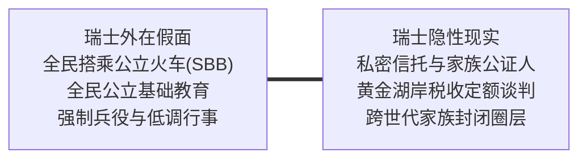

# 第1章 敏感话题：阶级为何在平等神话中讳莫如深 (A Touchy Subject)

## 章节概述与核心论题

保罗·福塞尔在开篇直指现代民主社会最虚伪的神经：**关于社会阶级的讨论，比性和金钱更为敏感与禁忌**。

美国人自建国以来便沉溺于“人人平等”与“白手起家”的意识形态神话。人们愿意承认收入有多寡、财富有厚薄，却极力否认“阶级”的存在。因为一旦承认阶级的真实存在，就等于承认民主社会并未能兑现机会平等的崇高诺言。福塞尔尖锐指出：**金钱只是阶级的副产品；定义社会层级的，是更深层的文化品味、行为习性、历史积淀与生活风格**。

---

## 原文核心段落翻译

### 1. 禁忌之火：戳破平等社会的皇帝新衣

> **原文**：  
> "When you write or talk about class, you can be sure of making people feel uncomfortable, and sometimes violently angry. For class is the dirtiest little secret in America. If you suggest that the United States is not a classless society, people are apt to regard you as a dangerous subversive or at best a cynic."  
> 
> **译文**：  
> “当你谈论或动笔描写阶级时，你可以确信，你一定会让人们感到局促不安，有时甚至会引发狂暴的愤怒。因为阶级是美国最肮脏的私密丑事。如果你暗示美利坚合众国并不是一个没有阶级的社会，人们往往会把你视作危险的颠覆分子，或者充其量是一个犬儒主义者。”

### 2. 金钱无法等同于阶级

> **原文**：  
> "Class is not defined by money alone. It is defined by taste, knowledge, perception, and a set of values so deeply ingrained that one is scarcely aware of them. A person can have millions of dollars and still remain hopelessly prole, just as someone living in genteel poverty can be unmistakably upper-middle class."  
> 
> **译文**：  
> “阶级绝非仅由金钱界定。它由品味、学识、敏锐的感知力以及一套根深蒂固到几乎不自知的价值观所决定。一个人可以坐拥数百万美元的家产，却依然是无可救药的无产阶级；正如一个过着体面清贫生活的人，可以是确凿无疑的中上阶层。”

---

## 社会学机制深度剖析

福塞尔的论断深刻承接了马克斯·韦伯（Max Weber）关于**阶级（Class）与声望地位（Status/Stand）**的经典分野：

1. **经济阶级与地位群体的脱节**：
   纯粹的市场能力（收入与资产）可以短期暴增，但地位声望依赖于群体的“排他性认同”（Social Closure）。暴发户即使在资产上压倒传统贵族，在社交场域中依然会被原住民精英用微观品味规则严密封锁。
2. **符号暴力与否认的合法性**：
   统治阶层越是宣扬“无阶级”，阶级壁垒就越稳固。因为在平等的假面下，底层的失败被合法化为“个人能力的不足”，从而彻底消解了对结构性不平等的制度反抗。

---

## 瑞士本土化全景适配：联邦平等神话与深层避风港秩序

瑞士是全球将“平等神话”表演得最严密、也最彻底的国度。

### 1. 瑞士式的“金钱禁忌”（Mer redet nöd über Geld）
- **瑞士现实**：在苏黎世、巴塞尔或伯尔尼，公开询问别人开什么车、买多大房子、或者具体赚多少薪水，是极严重的社交失礼。瑞士新教加尔文主义与慈运理教义植入了深刻的戒律：**财富是上帝秘密挑选的恩典，炫耀财富即是对信仰的亵渎**。
- **阶级暗语**：在瑞士社交圈，真正的顶级阶层从不谈论资产数额，而是谈论“祖父留下的林地维护”、“格劳宾登州阿尔卑斯古宅的木结构修复”或“某苏黎世历史行会（Zunft）的年会”。

### 2. 公共交通假面与顶级私密通道
- **表面现象**：在瑞士，联邦委员（Bundesrat，国家元首级）经常自己提着公文包在伯尔尼火车站与普通市民并肩等车。这种景象常被外人视作“绝对平等”的证据。
- **深层分流**：
  - 这种平民姿态是瑞士政商精英维护社会共识（Konkordanz）的必须防具。
  - 在看不见的维度，瑞士的老钱家族（如巴塞尔罗氏-霍夫曼医药世家、日内瓦私人银行Pictet/Lombard Odier合伙人），通过全封闭的家族办公室（Family Offices）、私密信托基金以及瑞士军刀般的公司股权结构，支配着庞大的全球资本，其私人直升机与圣莫里茨私密雪道从未在公众视野中曝光。

### 3. 新移民的“格调盲区”
- 许多新抵达瑞士的高净值移民，急于购置明黄色兰博基尼或佩戴大尺寸满钻名表在苏黎世班霍夫大街（Bahnhofstrasse）呼啸而过。
- 在本地瑞士人眼中，这种行为立刻被归入“品味低俗的外来暴发户（Neureich）”范畴，甚至会招致邻里委员会对生活噪音和合规性的严苛投诉，彻底丧失进入真正本地核心圈层的信任基础。
