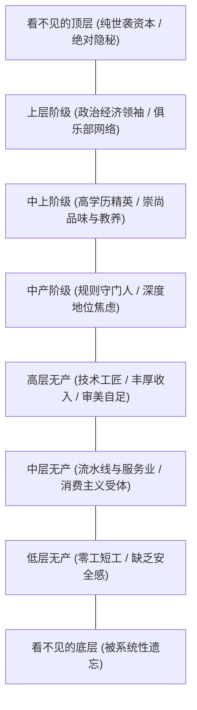

# 第2章 阶级解剖：从看不见的顶层到X类人 (An Anatomy of the Classes)

## 章节概述与核心论题

保罗·福塞尔在第二章绘制了著名的“九层社会阶层拓扑图”，并引入了游离于传统阶级引力之外的“X类人”。

福塞尔的核心发现是：**社会地位与“可见度”（Visibility）呈负相关**。最顶层与最底层都是“看不见的”；只有深陷地位焦虑的中产阶级与无产阶级，才被迫在公开视野中不断展示标识、工牌与消费符号来确证自身的存在。

---

## 原文核心段落翻译

### 1. 看不见的顶层（Top Out-of-Sight）

> **原文**：  
> "The top out-of-sight class is literally unseen. Their houses are hidden away in hills or deep in woods, down long driveways guarded by electronic gates. Their money comes entirely from inherited wealth, which is handled by anonymous trustees and family offices. They don't work, and they never enter the public sphere."  
> 
> **译文**：  
> “看不见的顶层阶层从字面意义上就是隐形的。他们的住宅深藏在群山之间或密林深处，隐匿在受电子铁门把守的漫长私人车道尽头。他们的财富完全来自继承遗产，由匿名的信托管理人和家族办公室全权打理。他们无需工作，也绝不在公共领域露面。”

### 2. 中产阶级：地位焦虑的终极受害者

> **原文**：  
> "The middle class is characterized by one word: anxiety. They are terrified of slips, slips in grammar, slips in decorum, slips in dress. Because they have no inherited security, they must constantly perform their respectability through scrupulous compliance with rules."  
> 
> **译文**：  
> “可以用一个词来概括中产阶级：焦虑。他们极度害怕出错——语法出错、礼仪出错、着装出错。因为他们没有世袭的底气，必须通过严苛遵守各类规则，时刻向外界证明自己的体面。”

---

## 社会学机制深度剖析

1. **可见性倒置法则**：越往上层，生活越私密；越往下层，生活越受公共制度监控。中产阶级生活在职场考核与邻里评价的透明金鱼缸中。
2. **安全感与表演欲的张力**：上层阶层无需取悦任何人，举止随性自然；中产阶级依靠后天专业技能立足，时刻处于害怕跌落的惊弓之鸟状态。

---

## 瑞士本土九大阶级微观对照表

结合瑞士联邦的经济地理与社会结构，福塞尔的九大阶层在瑞士呈现出高度本地化的对应物：

| 阶层层级 | 瑞士本土对应群体 | 财富与收入特征 | 居住地分布 | 核心生活方式与符号 |
| :--- | :--- | :--- | :--- | :--- |
| **看不见的顶层** (Top Out-of-Sight) | 巴塞尔罗氏霍夫曼家族、日内瓦私人银行百年合伙人家族、隐居低调国际财阀 | 数十亿瑞郎世袭信托，绝无任何打工痕迹 | 提契诺私密山庄、格劳宾登隐秘山谷、日内瓦湖私人码头领地 | 绝不在媒体露面；全封闭私人信托；私人艺术收藏；直升机出入 |
| **上层阶层** (Upper Class) | 历史行会（Zunft）资深理事、跨国巨头董事会常董、传统私立医院与银行董事 | 数千万瑞郎，数代经商或从政积累 | 苏黎世黄金湖岸（Küsnacht, Herrliberg）、楚格山半山独立庄园 | 圣莫里茨私密滑雪俱乐部（Corviglia）；帆船俱乐部会员；低调定制西装 |
| **中上阶层** (Upper-Middle) | 瑞士合伙制商业大律师、公立医院主任医师（Chefarzt）、ETH终身正教授、大行合伙人 | 年收入 40万–100万瑞郎，高度依赖专业人力资本 | 苏黎世湖沿岸（Stäfa, Meilen, Thalwil）、苏黎世Seefeld区高级公寓 | 坚决送子女冲刺Langgymnasium；支持苏黎世美术馆（Kunsthaus）；周末在瓦莱州高档木屋徒步 |
| **中产阶级** (Middle Class) | 跨国企业经理、公立初高中教师、资深软件工程师、银行中台合规主管 | 年收入 12万–25万瑞郎，双职工居多 | 各州郊区联排排屋（Reihenhaus）或城市外围社区 | 严格遵守垃圾分类与静音时间；全天候监控孩子学业；开沃尔沃/斯柯达旅行车；每年去马略卡度假 |
| **高层无产** (High-Prole) | 瑞士精密机械技师（Polymechaniker）、高阶制表匠（Horloger）、高级持证电工 | 年收入 10万–14万瑞郎，现金流充沛且极其稳定 | 阿尔高州、索洛图恩州等工业市镇独栋小别墅 | 对知识分子毫无敬畏；热衷重型摩托车、瑞士民俗摔跤（Schwingen）与露营车；全套专业电动工具 |
| **中层无产** (Mid-Prole) | 连锁超市（Coop/Migros）理货员、邮政投递员、普通餐饮服务人员 | 年收入 6万–9万瑞郎，储蓄率低 | 城市近郊租赁公寓大楼（Wohnblock） | 深度被现代快消品收割；喜好大Logo运动卫衣；抽烟并在阳台聚餐；观看真人秀 |
| **底层无产** (Low-Prole) | 建筑外包临时工、外卖骑手、家政小时工（多为非欧盟新移民） | 年薪 3万–5万瑞郎，朝不保夕 | 工业区廉租房、合租房 | 严重受困于语言门槛；生活完全被生存压力占据 |
| **看不见的底层** (Bottom Out-of-Sight) | 无证黑工、被驱逐边缘人员、长期隐匿避难者 | 无固定合法收入 | 庇护所、地下收容所 | 被瑞士严密的居留登记法（Einwohnerkontrolle）彻底边缘化 |
| **X类人** (Category X) | ETH/CERN独立科学家、先锋建筑师、独立双语作家、跨国自由软件黑客 | 收入波动但拥有充足被动生息资产，完全掌控个人时间 | 租住在老城旧屋（Altbau）或偏远山谷改装农舍 | 无视阶层攀比；穿耐穿工装与旧羊绒衫；阅读古典文献；自制黑胶与开源软硬件 |
