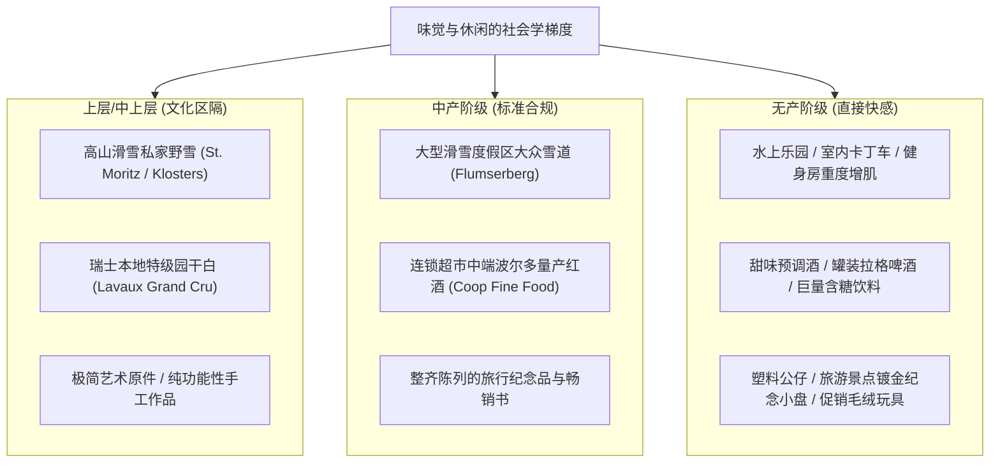

# 第5章 消费、消遣与小摆件：运动、红酒与度假圈层 (Consumption, Recreation, Bibelots)

## 章节概述与核心论题

保罗·福塞尔在第五章剖析了**闲暇时间如何充当最冷酷的阶层分水岭**。

当基本的生存温饱解决后，人如何花钱、如何度假、参与何种运动以及在客厅摆放什么小物件，成了衡量文化资本与社会地位的最精准试纸。福塞尔确立了休闲领域的四条铁律：
1. **运动的无功利性与昂贵门槛**：越往上层的运动，规则越复杂、装备与教练越昂贵、场地占用越大（帆船、马术、高山滑雪、击剑）；而无产阶级运动往往具有高对抗性、强感官刺激、规则简单且伴随大量现场观众（职业摔跤、拳击、保龄球）。
2. **味觉的“苦涩”与“微酸”法则**：上层青睐无糖、原味、微酸的干白葡萄酒与干性烈酒；底层则极度嗜好高糖、高脂、甜腻鸡尾酒与碳酸软饮。
3. **小摆件的死刑判决（Bibelot Curse）**：冰箱贴、旅游景点纪念盘、塑料水晶球和可爱小动物陶瓷摆件，是向访客宣告自己属于平民中产的最致命证据。

---

## 原文核心段落翻译

### 1. 运动的阶级门槛：远离喧嚣的人群

> **原文**：  
> "Upper-class sports are quiet, solitary, and expensive. They require vast expanses of open land or water, costly private gear, and years of patient instruction: sailing, skiing, horseback riding, and court tennis. Prole sports are noisy, crowded, and heavily scheduled, usually accompanied by screaming crowds, referee whistles, and commercial sponsorships."  
> 
> **译文**：  
> “上层阶级的运动是安静、孤寂且昂贵的。它们需要广袤的开阔水域或连绵山野、昂贵的私人定制装备，以及数年耐心的专业辅导：帆船航行、高山滑雪、英式马术以及传统草地网球。而无产阶级运动则是嘈杂、拥挤且高度按时刻表运作的，通常伴随着尖叫的人群、裁判刺耳的哨声以及铺天盖地的商业赞助。”

### 2. 味觉阶梯：从甜蜜到干涩

> **原文**：  
> "The prole palate is infantilized: it craves sweetness. Proles drink sweet sodas, fruity sugary cocktails with paper umbrellas, and eat mass-produced pies with sticky fillings. As you move up the social ladder, sugar vanishes. The upper classes favor bitter, sour, and astringent tastes: extra-dry martinis, bone-dry Chablis, black unsweetened espresso, and game meat."  
> 
> **译文**：  
> “无产阶级的味蕾是婴儿化的：它渴求甜味。无产阶级喝甜味汽水、插着纸伞的水果含糖鸡尾酒，吃夹着粘稠糖浆的量产派。而当你沿着社会阶梯向上攀登，糖分便彻底消失了。上层阶层偏爱苦涩、酸冽与微涩的口感：极干马提尼、酸度凛冽的夏布利干白、不加糖的意式浓缩纯黑咖啡，以及原生态野味。”

---

## 社会学机制深度剖析

- **布尔迪厄的“距离必要性的品味”（Taste of Necessity vs. Taste of Luxury）**：下层阶级由于经济限制，倾向于将消费价值绑定在“热量饱腹度”与“感官即刻满足”；上层阶级则有从容的资本去培养需要经过长期训练才能欣赏的复杂苦涩风味（Acquired Taste）。

---

## 瑞士本土化全景适配：阿尔卑斯雪山圈层、私家帆船与本土名酒图谱

瑞士作为欧洲顶级休闲度假圣地，其内部的消遣层级划分极其冷酷：

### 1. 滑雪度假的“微观地理鄙视链”
- **初级大众雪场（周日一日游）**：
  - 如弗卢姆泽贝格（Flumserberg）、霍赫伊布里格（Hoch-Ybrig）。
  - 周末清晨挤满从苏黎世总站出发的 S-Bahn 滑雪专线列车，多为普通工薪家庭、留学生与初学者，雪道拥挤，午餐在嘈杂的自助山顶餐厅排队买薯条与香肠。
- **中产度假胜地**：
  - 如达沃斯（Davos）、莱克斯（Flims-Laax）、英格堡（Engelberg）。
  - 设施现代化，聚集大量科技新贵与青年白领，滑雪后派对（Après-Ski）音乐震耳欲聋。
- **世袭老钱与贵族隐秘城堡**：
  - **圣莫里茨（St. Moritz）苏夫雷塔区（Suvretta）**与**克洛斯特斯（Klosters）**：英国皇室（查尔斯国王常客）与苏黎世古老银行家族的大本营。他们拥有私人滑雪缆车通道与专属向导，在私密会员俱乐部 Corviglia Club 内围炉品尝松露干酪，绝不参与大众雪道的人流拥堵。
  - **韦尔比耶（Verbier）与采尔马特（Zermatt）隐秘高地**：全球多语种金融精英与皇室后裔的避风港。

### 2. 水上休闲：私家游艇俱乐部 vs 公共露天浴场（Badi）
- 瑞士各湖泊的公共水上浴场（Badi）整洁卫生，是典型的全民福利。
- 但社会地位的分野在于：
  - **苏黎世游艇俱乐部（Yachtclub Zürich, YCZ）**或**日内瓦航海协会（Société Nautique de Genève, SNG）**的正式会员资格。
  - 入会需要两位资深会员连带引荐，且需证明数年的航海经验与个人声望。拥有一艘由瑞士传统船厂定制的木质复古帆船并在湖畔拥有终身专属泊位，是比拥有一辆法拉利更为罕见的阶层硬通货。

### 3. 瑞士饮食与本土红酒的“内行暗号”
- **暴发户的误区**：在苏黎世高级餐厅动辄点数千法郎的法国波尔多名庄拉菲（Lafite），这在本土侍酒师眼中属于典型的“毫无独立鉴赏力的外来新钱”。
- **瑞士本土老钱的鉴赏代码**：
  - 精通瑞士本国极为稀少、绝不外销的顶级独立酒庄（Grand Cru）。
  - 例如：格劳宾登州（Bündner Herrschaft）传奇酿酒师 **Gantenbein** 的限量黑皮诺（Pinot Noir）；沃州拉沃梯田（Lavaux）名庄的陈年沙斯拉（Chasselas）；或是瓦莱州极其古老冷门的本土葡萄品种小阿维涅（Petite Arvine）与科纳兰（Cornalin）。
  - 能够随口点评某位独立小农葡萄园坡向与日照年分的客人，才能获得本土资深圈层的无声接纳。
