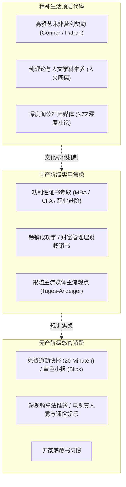

# 第6章 精神生活：名校崇拜、藏书品味与艺术赞助 (The Life of the Mind)

## 章节概述与核心论题

保罗·福塞尔在第六章揭示了最具杀伤力的隐性阶层过滤网：**智力消费与精神生活方式**。

福塞尔指出，一个人的精神生活是其家庭阶层背景最无可辩驳的证据。智力消费领域存在两条残酷的铁律：
1. **专业选择的“无功利性特权”**：只有真正拥有世袭财富底气的阶层，才敢让子女攻读纯古典学、艺术史、中世纪哲学或比较文学；而工薪中产则极力督导孩子学习实用技术、会计、市场营销等能快速兑现饭碗的专业。
2. **读物与媒介的严苛分流**：从大部头无图学术专著，到图文并茂的通俗杂志，再到廉价感官刺激的小报与短视频，媒介消费构成了一张不可逾越的文化种姓网。

---

## 原文核心段落翻译

### 1. 专业的无用性：有闲阶层的智力勋章

> **原文**：  
> "The choice of major is a definitive index of class. The upper classes study useless subjects: classics, art history, philosophy, renaissance literature. These subjects proclaim that the student will never need to earn a living by practicing a practical trade. The middle and prole classes study vocational subjects: marketing, communications, computer programming, and business administration."  
> 
> **译文**：  
> “大学专业的选择是阶级最明确的索引。上层阶级研读‘无用之学’：古典文献学、艺术史、纯哲学与文艺复兴文学。这些学科庄严宣告：学生此生绝不需要依靠一门谋生手艺来换取面包。而中产与无产阶级则钻研职业化科目：市场营销、大众传播、计算机编程以及工商管理。”

### 2. 书架上的阶级印记

> **原文**：  
> "You can read a person's social class from across the room by glancing at the bookshelves. The upper-middle-class house has floor-to-ceiling shelves crowded with serious hardcovers, history, foreign-language literature, and unread literary quarterlies. The middle-class home has bestsellers, cookbooks, and self-help paperbacks. The prole home has no books at all, only televisions."  
> 
> **译文**：  
> “只需扫一眼房间另一端的书架，你就能判定主人的社会阶级。中上阶层的宅邸拥有通顶书架，挤满了严肃硬皮书、历史通史、外文原版文学以及看似从未翻阅过的文学季刊。中产阶级的家中摆放着当季畅销书、烹饪指南与心灵励志平装书。而无产阶级家中根本没有书，只有电视屏幕。”

---

## 社会学机制深度剖析

- **布尔迪厄的“纯正文化资本与合法文化”**：艺术赞助不是简单的消费，而是将经济资本转化为“合法性声望”的最高级洗礼。
- **无功利审美的象征权力**：能够欣赏复杂的现代古典音乐或晦涩的哲学论辩，代表着摆脱了日常生存苦役的精神崇高性。

---

## 瑞士本土化全景适配：大学网络、纸媒圣经与艺术赞助人圈层

在高等教育高度发达的瑞士，精神生活的阶层壁垒不仅没有被抹平，反而由于精英私立体系的存在而更加幽深：

### 1. 瑞士大学的隐形性格坐标
- **苏黎世联邦理工学院（ETH Zürich）**：
  - 全球理工巅峰，但其精神气质偏向“技术官僚与硬核科学家”。无论家庭背景如何，全凭数学与编程硬实力决胜，具有高度的技术中产色彩。
- **圣加仑大学（HSG, Universität St. Gallen）**：
  - 瑞士传统政商统治阶层的“摇篮与名利场”。
  - 拥有全德语区最庞大且排他的校友网络（HSG Alumni）。学生早早身着无褶正装出入于苏黎世湖畔的投行宣讲会，是典型的“瑞士建制派精英（Swiss Establishment）”孵化基地。
- **罗曼德湖区贵族寄宿学校体系**：
  - 如萝实学院（Institut Le Rosey）、博所莱伊学院（Beau Soleil）、艾格隆学院（Aiglon College）。
  - 年学费高达 15 万至 18 万瑞士法郎，招收全球王室后裔、外交官子弟与福布斯富豪家族后代。它们与瑞士公立平民教育完全脱轨，构成了一个完全封闭的跨国世袭精英温室。

### 2. 瑞士报刊媒介的阶级光谱
在苏黎世早晨的电车或火车车厢内，乘客手中的读物精确暴露其阶层属性：
- **无产阶级与蓝领通勤族**：
  - 翻阅免费分发的《20分钟》（*20 Minuten*）或街头购买的《一瞥报》（*Blick*）。其内容充斥着绯闻八卦、交通事故与煽动性体育新闻。
- **标准中产阶级**：
  - 阅读《每日导报》（*Tages-Anzeiger*）或各州地方日报，关注学区政策、公共交通调价与周末消费指南。
- **瑞士保守老钱与高阶精英的唯一圣经**：
  - **《新苏黎世报》（NZZ, Neue Zürcher Zeitung）**。
  - NZZ 创刊于 1780 年，版面长年保持沉稳无浮夸大图的黑白排版风格。其国际深度评论、深度经济学分析与高雅文艺副刊（Feuilleton），是进入苏黎世老钱家族与私人银行董事会对话的强制性智力入场券。

### 3. 文化赞助人制度（Mäzenatentum）：苏黎世高雅社交的通关密码
- **艺术品味准则**：
  - 仅买票参观展览属于普通游客中产。
  - 真正的瑞士上层，是**苏黎世美术馆协会（Zürcher Kunstgesellschaft）**、**苏黎世歌剧院之友（Freunde der Oper Zürich）**或**苏黎世市政音乐厅管弦乐团（Tonhalle-Orchester Zürich）**的正式常务赞助人（Gönner）。
- **社交回报**：
  - 赞助人不仅拥有年度私人预览会特权，其姓名还会被刻印在美术馆新展厅的石墙上（如由大卫·奇普菲尔德设计的新苏黎世美术馆扩展翼）。
  - 在私人预展酒会上与策展人、百年家族族长轻声交谈对现当代先锋装置的独到理解，是跻身瑞士本土核心社交圈最坚固的文化桥梁。
