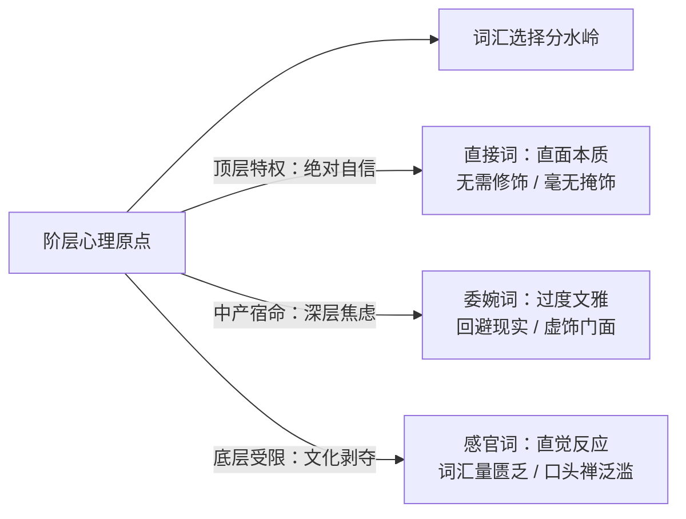

# 第7章 开口说话，我便看清了你：语言、词汇假面与口音隐性过滤器 ("Speak, That I May See Thee")

## 章节概述与核心论题

保罗·福塞尔在第七章引用了英国剧作家本·琼森（Ben Jonson）的名言：**“语言最能暴露一个人的本质：开口说话吧，好让我看清你。”**

福塞尔指出，即便一个人在服饰、汽车和住宅上伪装得天衣无缝，只要他一开口说话，其阶层出身便在数秒之内彻底暴露。语言领域存在三条不可逆的阶级烙印：
1. **中产阶级的“过度文雅与委婉病”（Euphemism Epidemic）**：中产阶级极度害怕粗俗，因而生造出大量繁复、虚伪的拉丁目标委婉词（如用“卫生设施/洗手间”替代“厕所”，用“离世/往生”替代“死亡”）；而顶层阶级则自信使用最直接、粗砺且精准的古老单音节词。
2. **语流的“从容度”与“紧绷感”**：底层语言贫瘠且充斥着市井俚语；中产语言充满谨小慎微的书面语法自我修正；上层语言则带有一种居高临下的慵懒、不屑于解释的从容以及对语病毫不介怀的漫不经心。
3. **官僚黑话与行话通胀**：越是缺乏实权的中层白领，越喜欢在日常对话中堆砌商业管理学缩写与宏大词汇。

---

## 原文核心段落翻译

### 1. 委婉语：中产阶级不安的护身符

> **原文**：  
> "The middle class lives in mortal terror of the plain word. It cannot say 'toilet,' it must say 'restroom' or 'powder room.' It cannot say 'rich,' it must say 'wealthy' or 'comfortable.' It cannot say 'die,' it must say 'pass away.' By wrapping reality in layers of verbal cotton wool, the middle class hopes to demonstrate its delicate sensitivity, but succeeds only in advertising its pathetic status anxiety."  
> 
> **译文**：  
> “中产阶级生活在对朴素词汇的致命恐惧中。他们不能说‘厕所’，非要说‘洗手间’或‘化妆室’；他们不能说‘有钱’，必须说‘富裕’或‘生活宽裕’；他们不能说‘死’，非要说‘离世’。通过将残酷现实包裹在层层语言药棉之中，中产阶级妄图展示自己的高尚与体面，却仅仅成功招摇了自己可悲的地位焦虑。”

### 2. 顶层的语言自信：粗砺与直白

> **原文**：  
> "The upper class, secure in its ancestral position, speaks with an almost brutal simplicity. It has no need to impress anyone. It says 'house,' not 'residence'; 'drunken,' not 'intoxicated'; 'sweat,' not 'perspire.' It uses Anglo-Saxon monosyllables while the middle class scrambles for multi-syllabic Latinate inflations."  
> 
> **译文**：  
> “上层阶级依仗着祖辈沉淀的世袭地位，说话带着近乎粗鲁的简朴。他们毫无取悦他人的需要。他们说‘房子’而非‘官邸’；说‘醉了’而非‘酒精中毒’；说‘出汗’而非‘排汗’。当上层阶级自如运用质朴有力的原生词汇时，中产阶级却在手忙脚乱地搜刮那些臃肿冗长的高级外来词汇。”

---

## 社会学机制深度剖析

- **巴兹尔·伯恩斯坦的“受限代码与精密代码”（Restricted vs. Elaborated Code）**：不同阶级的语言代码结构深刻规训了思考复杂性。
- **布尔迪厄的“语言资本与听觉合法性”**：发音的从容度、抑扬顿挫的音乐感，构成了社会交往中最难被后天速成的“声学阶级壁垒”。

---

## 瑞士本土化全景适配：瑞士德语方言密码、双重语言屏障与外来移民陷阱

瑞士的语言生态是全球最复杂、最奇特的阶层识别试验场：

### 1. 瑞士德语方言（Schwyzerdütsch）的“内生社群准生证”
- **与德国内部阶层规律的逆转**：
  - 在德国或英国，讲当地方言往往是底层或乡村蓝领的标志，讲标准德语（Hochdeutsch）或标准英音（RP）是精英阶层的特征。
  - **瑞士发生完全逆转**：在瑞士德语区，从百亿私人银行家、联邦委员到建筑水暖工，日常非正式交流**一律使用瑞士德语方言（Schwyzerdütsch）**！
  - 瑞士德语不是方言，而是“瑞士本土血缘与共同体认同的隐形护照”。
- **德国高管与跨国新移民的“语言死局”**：
  - 许多来自德国的跨国企业高管，虽然讲着一口极其标准傲慢的高地德语，但在苏黎世黄金湖岸的私人聚会或学校家长会中，依然被本地人视作外来的“客籍打工人”（Schwaben / Expats）。
  - 能否自如听懂、并在非正式交谈中熟练切换瑞士德语俚语，是打破本地老钱社交冷漠的决定性开关。

### 2. 瑞士各地方言的“微观贵族光谱”
即便同为瑞士德语，口音依然包含着严苛的阶层鄙视链：
- **苏黎世城郊工业口音（Züri Unterland / Glattal）**：带有较多工业区年轻人的平民吞音与粗砺语调。
- **苏黎世老城与湖岸贵胄腔调（Daig / Patrizier-Zürichdeutsch）**：
  - 语速慢、发音极其清晰圆润、尾音优雅轻抬。
  - 混杂着法语句法与古典拉丁语格言的自然流露。
- **巴塞尔传统贵族方言（Basler Patrizier-Dialekt）**：
  - 巴塞尔古老化工医药家族（如“Daig”圈层）特有的方言腔调，鼻音轻柔，用词古雅，自成一体，外界极难模仿。

### 3. 多语种自由切换：瑞士高阶精英的终极体面
- **语言通关金标准**：
  - 中产阶级为德语证书（Goethe C1/C2）的语法填空而战战兢兢。
  - 真正的瑞士跨国高阶精英（如 UBS 投资银行高层、日内瓦私人银行家）：
    - 在苏黎世用圆润的瑞士德语和邻居打招呼；
    - 切换到纯正无口音的高地德语签署法律条约；
    - 在电话里用极为优雅的 18 世纪罗曼德法语讨论拉沃酒庄收成；
    - 在国际金融会议上使用精炼流畅的牛津英语主持并购案。
  - 这种在四种语境间游刃有余、毫不费力的高级语码转换（Code-Switching），是瑞士最高阶文化资本的无可替代的终极图腾。
