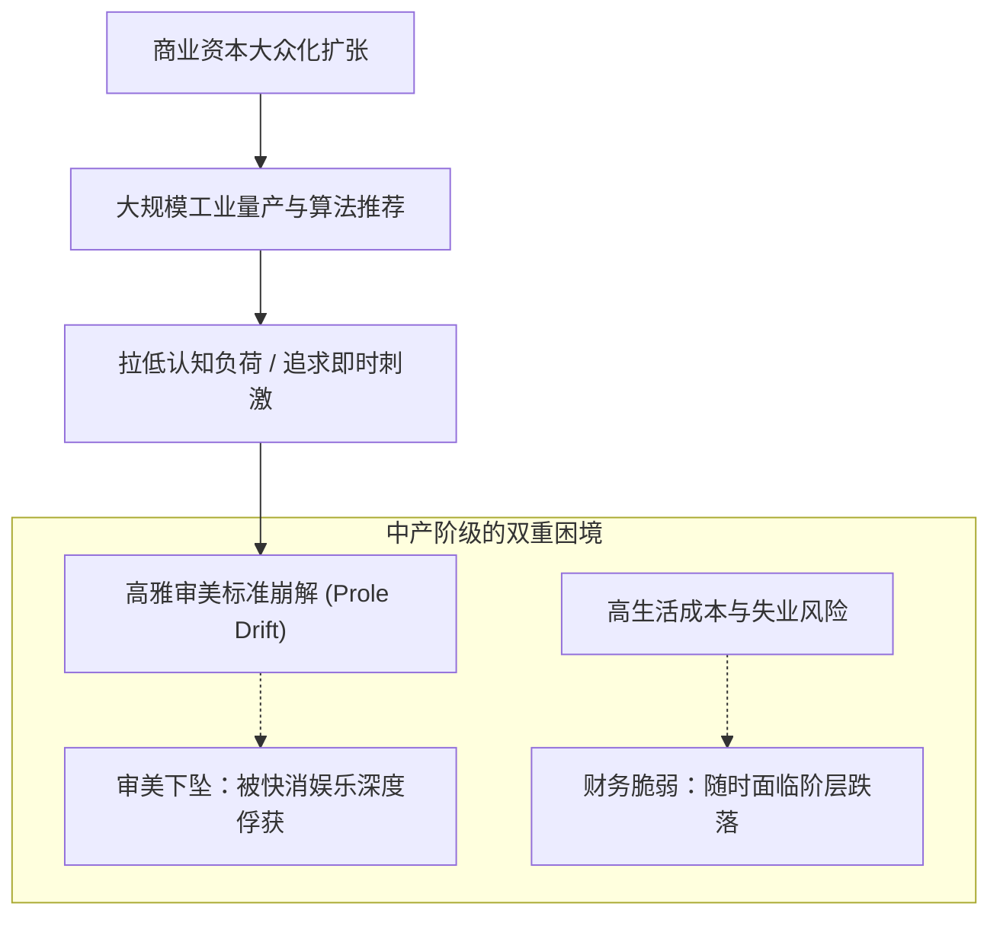

# 第8章 阶级跃迁、跌落与无产阶级漂移 (Climbing and Sinking, and Prole Drift)

## 章节概述与核心论题

保罗·福塞尔在第八章剖析了现代社会最普遍的心理病灶与文化熵增现象：**地位升降的剧烈焦虑，以及无法逆转的“无产阶级漂移”（Prole Drift）**。

福塞尔指出：
1. **攀爬者的“过度法则”（The "Too" Principle）**：试图实现阶级跃迁的新贵，总是在细节上暴露无遗——他们的车太干净、鞋太锃亮、衣服太笔挺、举止太周全。真正的老钱带着从容的残缺，而攀爬者带着拼命用力的紧绷。
2. **地位滑落的冷酷重力**：中产阶级无论账面薪资多高，其社会地位本质上建立在脆弱的受雇契约上。一次中年失业、一场重病或一次离婚，就能迅速剥夺其精心维持的中上层体面。
3. **无产阶级漂移（Prole Drift）**：商业资本主义的不可逆趋势，就是通过大众营销将原本专属于精英阶层的高雅文化不断稀释、降级、庸俗化，最终将整个社会的品味拉低至最省力、最廉价的无产阶级底线。

---

## 原文核心段落翻译

### 1. 攀爬者的致命伤：用力过猛

> **原文**：  
> "The climber is immediately betrayed by doing everything too well. His suit is too clean, his shoes too shiny, his haircut too fresh, and his vocabulary too conspicuously correct. The upper class knows that ease, not precision, is the soul of true distinction. Perfection is the unmistakable hallmark of the social parvenu."  
> 
> **译文**：  
> “向上攀爬者往往因为把每件事都做得‘太好’而立刻暴露无遗。他的西装太干净，皮鞋太锃亮，发型太新鲜，词汇也太刻意追求正确。上层阶级深知，松弛从容、而非精准无暇，才是真正卓尔不群的灵魂所在。尽善尽美，恰恰是社会暴发户最无可辩驳的鲜明烙印。”

### 2. 无产阶级漂移：品味的不可逆熵增

> **原文**：  
> "Prole drift is the tendency of everything in modern civilization to become lower, cheaper, noisier, and less demanding. Airports become bus stations; colleges become trade schools; books become comic strips; restaurants become troughs for feeding; and polite speech collapses into guttural grunts. It is the gravitational pull of the lowest common denominator."  
> 
> **译文**：  
> “无产阶级漂移，是现代文明中一切事物都不可逆转地走向更低俗、更廉价、更嘈杂且更不费脑力的趋势。机场沦为长途汽车客运站；大学退化为职业技校；大部头经典简化为连环画；典雅餐厅变成填饱肚皮的饲料槽；而温文尔雅的交谈瓦解为喉咙底部的咕哝声。这是大众最低公约数无可抗拒的下坠引力。”

---

## 社会学机制深度剖析

- **资本主义的商品化平庸**：为了追求利润最大化，文化产业必须生产不需要专业训练就能消费的快餐产品。
- **凡勃伦的“阶级渗透法则”**：高级阶层的符号一旦被大众廉价模仿，上层就会立刻抛弃该符号，寻找更加隐秘、不可复制的区隔特征。

---

## 瑞士本土化全景适配：高薪移民的滑落幻觉与瑞士社会的抗漂移保卫战

在人均收入全球名列前茅的瑞士，这一章揭示了极为切肤的生存现实：

### 1. 瑞士跨国高薪族（Expats）的“纸面富贵与滑落恐惧”
- **虚幻的高收入陷阱**：
  - 许多在苏黎世（如 Google 欧洲总部、国际投行、大型药企）年薪达到 30万至 50万瑞郎的高级工程师与总监，表面上处于瑞士收入金字塔顶端 5%。
  - 但其社会地位高度脆弱：瑞士劳动法极为灵活，解雇无需理由（Kündigungsfreiheit），没有任何法定的高额遣散赔偿。
- **断崖式坠落链条**：
  - 一旦遭遇行业裁员，苏黎世失业救济金（RAV）的法定封顶支付额仅为每月约 12,350 瑞士法郎，最多领取 400 至 520 个工作日。
  - 在高昂的房租/房贷、全额自费的昂贵托儿费以及昂贵的医疗保险（Krankenkasse）重压下，高薪外籍家庭的现金储备往往在 18 个月内被迅速耗尽，不得不接受“阶层滑落并被迫离开瑞士”的残酷现实。

### 2. 瑞士日常生活的“无产阶级漂移”微观病理
即便是欧洲最严谨传统的瑞士，也无法完全抵御现代庸俗化的侵蚀：
- **传统街区风貌的退化**：
  - 历史小镇（如施泰法、屈斯纳赫特）中代代相传的独立手作面包房（Bäckerei）与传统手工肉铺（Metzgerei），逐渐被连锁巨头 Coop 和 Migros 的冷冻工业半成品面包柜台所取代。
- **穿搭礼仪的断崖下坠**：
  - 曾经需要正装出席的苏黎世湖畔音乐会，如今常能见到身穿运动抓绒裤、手拿星巴克纸杯的大众听众。
- **基础公立教育的标准妥协**：
  - 随着新移民比例激增，公立小学（Volksschule）为了照顾多元文化融合，教学大纲（Lehrplan 21）不断降低抽象逻辑与传统正字法德语的考核严苛度，促使真正追求卓越的中上层家庭必须自费进行深度的课外补刀。

### 3. 如何在瑞士对抗“无产阶级漂移”？
- **审美防御（Aesthetic Defense）**：
  - 坚决抵制社交媒体算法的信息喂养，坚持精读德文/英文纸质长篇经典。
  - 在孩子日常生活中杜绝快餐化垃圾食品，建立对食材原本风味、传统手工艺品与古典音乐的敏感触觉。
- **财务结构防御**：
  - 摆脱对单一打工月薪的过度依赖，效仿瑞士本土老钱家族，将流动资产转化为高壁垒的不动产、生息资产与自主掌控的商业实体，构建抵御劳动力市场周期的坚实安全垫。
