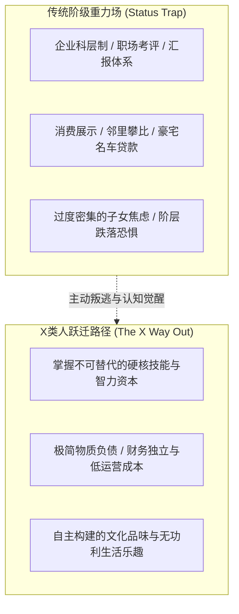

# 第9章 X类人的出路：摆脱阶级重力的自主生存哲学 (The X Way Out)

## 章节概述与核心论题

保罗·福塞尔在全书的终章，给出了冲破这套令人窒息的社会等级监牢的唯一出路：**成为“X类人”（Category X）**。

福塞尔指出，“X类人”不是位于阶级金字塔某一层的阶层，而是**一批主动退出地位攀比游戏、获得心智与生活方式主权的自由人**。他们拥有上层阶级的好奇心与自由度，具备中上阶层的文化教养，却彻底摒弃了中产阶级的焦虑伪善与无产阶级的被动麻木。X类人的本质，是建立在深厚智力资本与经济自足之上的**生活主权者**。

---

## 原文核心段落翻译

### 1. 什么是X类人：彻底的阶级叛逃者

> **原文**：  
> "Category X people are an unmonitored class. They are free from the nervous surveillance of bosses, neighbors, and peer groups. They occupy a curious position: though born into the middle or prole classes, they have somehow escaped. They have created for themselves an enclave of autonomy, living by their own wits, tastes, and eccentric standards."  
> 
> **译文**：  
> “X类人是一个不受监控的阶级。他们彻底摆脱了来自上司、邻居以及同侪群体的紧张审视。他们占据着一个奇特的位置：尽管出生于中产或无产阶层，他们却以某种方式成功完成了大逃亡。他们凭借自己的机智、品味以及特立独行的标准，为自己创造出了一片自主生活的飞地。”

### 2. X类人的衣着与精神面貌：舒适与主权

> **原文**：  
> "You can spot an X person by their magnificent indifference to fashion. They wear comfortable, timeless garments: battered corduroy trousers, tweed jackets with elbow patches, sturdy walking boots, and sweaters knitted from raw wool. They read voraciously, listen to complex music, and cook without reference to commercial trends. They are the only truly free people in a society chained to status anxiety."  
> 
> **译文**：  
> “通过他们对时尚潮流的崇高漠视，你可以一眼认出X类人。他们穿戴舒适、永不过时的衣物：有些磨损的灯芯绒长裤、肘部带有补丁的花呢夹克、结实的徒步靴，以及纯羊毛手织毛衣。他们贪婪地阅读，聆听复杂的音乐，烹饪时从不参考商业流行趋势。在一个被地位焦虑深深奴役的社会中，他们是唯一真正自由的人。”

---

## 社会学机制深度剖析

- **布尔迪厄的“异端习性”（Heretical Habitus）**：拥有极高的文化资本，却拒绝将文化资本作为统治或规训他人的工具，反向利用其作为保护个体精神不受商业资本异化的盾牌。
- **完全解构社会可见性**：X类人不需要通过任何商标或外部机构背书来证明自我价值。他们的自信完全来自对复杂事物的理解能力和解决问题的实际力量。

---

## 瑞士本土化全景适配：瑞士联邦的X类人栖息地与高维生存指南

在制度极其稳定、公共秩序高度健全的瑞士，实践“X类人”生活方式拥有得天独厚的全球最高土壤：

### 1. 瑞士X类人的典型社会画像
- **典型代表**：
  - 在日内瓦欧洲核子研究中心（CERN）从事前沿弦理论推演的粒子物理学家；
  - 隐居在汝拉山谷（Vallée de Joux）古老农舍中、为独立制表品牌研发超复杂陀飞轮机芯的独立制表大师；
  - 在苏黎世老城（Niederdorf）开辟独立书店、从事多语种哲学翻译的自由学者；
  - 早年通过高维技术创业获得财务自足、现长年定居在提契诺高山村落从事开源软硬件开发的系统架构师。

### 2. 瑞士X类人的日常生活代码
- **出行方式**：
  - 拥有一辆保养极佳的复古手工钢架公路自行车，或一辆车龄二十年、没有任何行车电脑辅助但机械结构坚如磐石的沃尔沃老式旅行车。
  - 热衷使用瑞士联邦铁路（SBB）半价卡（Halbtax），乘坐列车穿越阿尔卑斯长程隧道，在二等车厢靠窗位置静心阅读德语原版历史专著。
- **饮食与居住**：
  - 避开黄金湖岸富豪区昂贵而虚饰的鸡尾酒社交，选择居住在拥有独立小菜园的传统老石屋中。
  - 直接在当地农户自营的无人售卖农场小店（Hofladen）购买新鲜苹果、生牛奶与黑麦酵母面包，自制发酵食品与手工奶酪。
- **山野消遣**：
  - 持有瑞士阿尔卑斯俱乐部（SAC）资深会员证，携带简单耐磨装备，在海拔 3000 米的无人冰川与高山荒原徒步；对商业化网红雪场的人群嗤之以鼻，醉心于纯野外攀登（Skitouren）。

### 3. 给第一代华人高净值家庭的终极启示：超越“马歇尔夫人”与“温迪·德赖弗”
- **双重陷阱的超越**：
  - 既不落入**第10章温迪·德赖弗（Wendy Driver）**那种工薪阶层任由教育体系宰割的“完全顺从与被动成长”；
  - 也不陷入**第8章斯泰茜·马歇尔（Stacey Marshall）**那种时刻紧绷、用金钱和过度控制把孩子的生活变成疲惫赛道的“中产焦虑窒息”。
- **X类人育儿范式**：
  - 稳稳护航孩子掌握攻克瑞士文理中学统考（ZAP）所需的底层数理与德语学术资本；
  - 同时彻底卸下向邻里和亲友“展示成功”的表演欲，带领孩子在瑞士壮丽的雪山、森林与古典文学中培养真正深邃的精神主权与从容气度。
