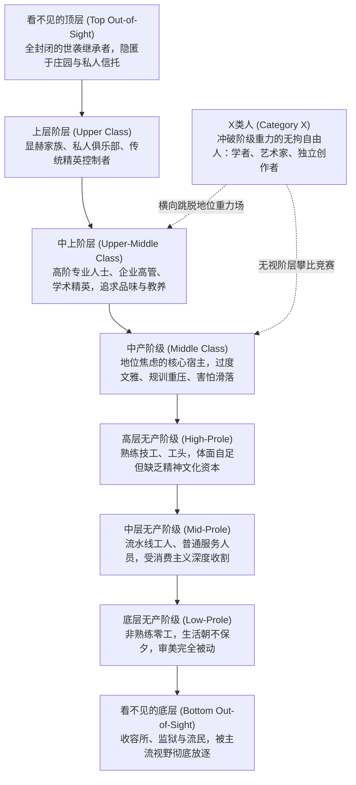

# 专栏导言：保罗·福塞尔《格调》与现代社会符号学 (Introduction: Deciphering Social Status Codes)

## 书籍背景与历史地位

1983年，美国著名文化历史学家、宾夕法尼亚大学文学教授**保罗·福塞尔（Paul Fussell）**出版了《格调：社会阶级与生活品味》（*Class: A Guide Through the American Status System*）。该书一经问世便引发轰动，迅速成为西方现代社会学与日常生活批评的传世经典。

福塞尔以极其辛辣、幽默且解剖刀般精准的笔触，刺破了现代社会最核心的政治神话——“我们是一个没有阶级的平等社会”。他指出，在现代民主制度下，法律与政治权利的形式平等，非但没有消灭阶级，反而促使阶级区隔退缩至成千上万个极其微妙、隐蔽且严酷的**日常生活符号体系**之中。

---

## 福塞尔九大阶级拓扑学与“X类人”

福塞尔突破了马克思主义纯粹基于“生产资料占有”的二元论，也修正了单纯依据“收入数值”的统计学划分，构建了一套立体的社会声望金字塔：

---

## 为何必须进行“瑞士本土化”重构？

福塞尔在书中主要剖析了20世纪晚期美国的社会符号（如聚酯纤维面料、车道碎石、高尔夫俱乐部与快餐文化）。如果机械套用这些美国意象，读者将无法理解身处欧洲大陆金融核心的现实世界。

**瑞士联邦（Switzerland）展现了一种全球最独特、最隐蔽的阶层生态**：

1. **慈运理与加尔文主义的“新教禁欲滤镜”**：
   苏黎世与日内瓦的深层老钱（Altgeld）绝不会像迈阿密或迪拜新贵那样炫耀跑车与满身大Logo。瑞士社会的最高美德是**“低调”（Diskretion）**与**“克制”（Understatement）**。炫富在瑞士会被视为粗俗无礼，导致社会性排斥。
2. **地理区隔与湖岸隐形围墙**：
   从苏黎世湖黄金湖岸（Goldküste，如 Küsnacht, Herrliberg, Stäfa）的避税庄园，到楚格州（Zug）的对冲基金聚集区，再到日内瓦湖畔（Lac Léman）的私人银行世家，资本被层层深锁在信托、匿名控股与百年私人公证处中。
3. **语言与口音的阶级天花板**：
   在瑞士德语区，瑞士德语方言（Schwyzerdütsch）是本土人情社会的“通行证”，而标准高地德语（Hochdeutsch）与纯正法语则构成了跨国高阶圈层的书面过滤机制。
4. **教育路径的阶级分野**：
   全民免费的优质公立学校覆盖中产与工薪；而文理中学统考（ZAP）筛选出本土学术精英；同时，罗曼德湖区年学费高达15万瑞郎以上的古老私立寄宿学校（如 Institut Le Rosey, Beau Soleil, Aiglon），则专门服务全球顶层看不见的世袭财阀。

---

## 章节索引全览

- [第1章 敏感话题：阶级为何在平等神话中讳莫如深](/docs/fussell-class/a-touchy-subject)
- [第2章 阶级解剖：从看不见的顶层到X类人](/docs/fussell-class/an-anatomy-of-the-classes)
- [第3章 外表算数：身材、衣着层次与无Logo静奢](/docs/fussell-class/appearance-counts)
- [第4章 住宅与环境：湖岸别墅、极简审美与空间私密性](/docs/fussell-class/about-the-house)
- [第5章 消费、消遣与小摆件：运动、红酒与度假圈层](/docs/fussell-class/consumption-recreation-bibelots)
- [第6章 精神生活：名校崇拜、藏书品味与艺术赞助](/docs/fussell-class/the-life-of-the-mind)
- [第7章 开口说话，我便看清了你：语言、词汇假面与口音隐性过滤器](/docs/fussell-class/speak-that-i-may-see-thee)
- [第8章 阶级跃迁、焦虑与无产阶级漂移](/docs/fussell-class/climbing-and-sinking-and-prole-drift)
- [第9章 X类人的出路：摆脱阶级重力的自主生存哲学](/docs/fussell-class/the-x-way-out)
- [附录 瑞士生活格调测试问卷与读者问答](/docs/fussell-class/appendix-exercises-and-mailbag)
